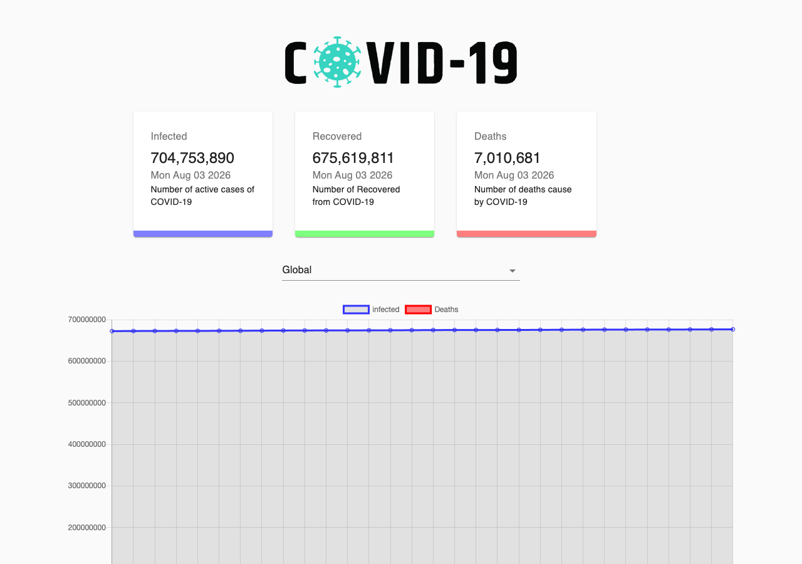

# COVID-19 Tracker

A React dashboard that visualizes global and country-level COVID-19 statistics with animated counters and interactive charts.

**[Live Demo](https://react-corona-app.surge.sh)**



## What it does

- Fetches live COVID-19 data from the [disease.sh](https://disease.sh/) API
- Displays infected, recovered, and death counts with animated number transitions
- Shows a global daily trend line chart (cases and deaths over the last 30 days)
- Lets you pick a country from a dropdown to switch to a bar chart for that region
- Responsive layout that works on desktop and mobile

## Tech stack

| Layer | Tools |
| --- | --- |
| UI | React 16, Material-UI |
| Charts | Chart.js, react-chartjs-2 |
| Data | Axios |
| Animations | react-countup |
| Build | Create React App |
| Deploy | Surge (via GitHub Actions) |

## Getting started

```bash
git clone https://github.com/itsnoormuhammad/react-corona-app.git
cd react-corona-app
yarn install
yarn start
```

Open [http://localhost:3000](http://localhost:3000). The dev server hot-reloads as you edit.

### Build for production

```bash
yarn build
```

The optimized static files are output to the `build/` folder.

## Project structure

```
src/
├── api/              # API calls and data shaping
├── components/
│   ├── Cards/        # Stat cards (infected, recovered, deaths)
│   ├── Chart/        # Line and bar charts
│   └── CountryPicker/# Country dropdown
├── App.js            # Root component and state
└── index.js          # Entry point
```

## Deployment

Pushes to `master` trigger a GitHub Actions workflow that builds the app and deploys to Surge at [react-corona-app.surge.sh](https://react-corona-app.surge.sh).

To deploy manually:

```bash
yarn build
npx surge ./build your-domain.surge.sh
```

## API

Data is provided by [disease.sh](https://disease.sh/) — a free, open COVID-19 API. The original [covid19.mathdro.id](https://covid19.mathdro.id/) endpoint used in early tutorials is no longer available, so this project uses disease.sh instead.

## License

MIT
